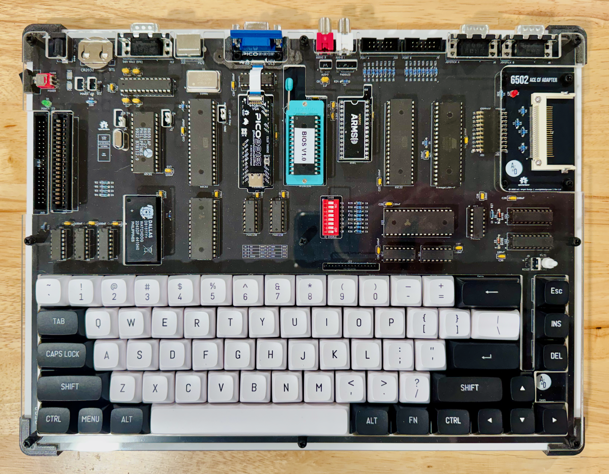

6502-ACE
========



An **AC6502** retro-style 8-bit computer based on the **65C02** microprocessor.

> 📖 **Guide:** [AC6502 Documentation](https://acwright.github.io/6502-DOCS/) — the user's and programmer's guide for the whole family.
> Start with [Your ACE](https://acwright.github.io/6502-DOCS/your-ace), the tour of this board.

---

**Building one? Every part you need, with supplier numbers and known issues, is in [BOM.md](BOM.md).**

## Table of Contents

- [Overview](#overview)
- [Architecture](#architecture)
- [Systems](#systems)
- [Software](#software)
- [Hardware](#hardware)
  - [ACE Board](#ace-board)
    - [Known limits](#known-limits)
  - [ACE CF Adapter](#ace-cf-adapter)
  - [ACE RAM Patch](#ace-ram-patch)
- [Firmware](#firmware)
  - [Video card](#video-card)
  - [AB Controller](#ab-controller)
- [CAD](#cad)
- [Production](#production)
- [Schematics](#schematics)
- [Docs](#docs)
- [Checking the schematics](#checking-the-schematics)
- [Checking the banked RAM](#checking-the-banked-ram)
- [Libraries](#libraries)
- [Bill of Materials](#bill-of-materials)
- [License](#license)

---

## Overview

The AC6502 ecosystem is a family of open-source, 65C02-based computers sharing a common architecture, memory map, and [BIOS](https://github.com/acwright/6502-BIOS). Each computer in the family is purpose-built for a different use case but runs the same software and firmware.

The **ACE** (All-in-one Computer Experience) is a complete, self-contained 65C02 computer on a single PCB. It integrates everything found across the COB's modular cards — CPU, memory, video, audio, storage, serial, GPIO, RTC, and keyboard controller — onto one board, delivering the full experience without a backplane or expansion cards.

## Architecture

All AC6502 computers share:

- **CPU**: 65C02 (or accurate emulation)
- **Memory**: 32KB RAM + 32KB ROM, with optional banked RAM expansion
- **Memory Map**: Standardized across the ecosystem — zero page, stack, I/O space ($8000–$9FFF), system ROM, and interrupt vectors at $FFFA–$FFFF
- **Bus**: 16-bit address bus, 8-bit bidirectional data bus, standard 65C02 control signals (RW, PHI2, RESET, IRQ, NMI, RDY, SYNC)
- **BIOS**: A common [BIOS](https://github.com/acwright/6502-BIOS) provides the kernel, monitor, and BASIC interpreter across all systems

## Systems

| Project | Description |
|---------|-------------|
| [6502-ACE](https://github.com/acwright/6502-ACE) | All-in-one Computer Experience — A single board computer (YOU ARE HERE) |
| [6502-COB](https://github.com/acwright/6502-COB) | Computer On a Backplane — Modular desktop computer with expandable card slots |
| [6502-DEV](https://github.com/acwright/6502-DEV) | Development Environment Vehicle — Emulation-based dev system |
| [6502-KIM](https://github.com/acwright/6502-KIM) | Keypad Input Monitor - KIM-1 inspired minimal computer |
| [6502-VCS](https://github.com/acwright/6502-VCS) | Video Computer System — Cartridge-based retro gaming console |

## Software

| Project | Description |
|---------|-------------|
| [6502-BIOS](https://github.com/acwright/6502-BIOS) | The shared BIOS (kernel, monitor, BASIC) for all AC6502 computers |
| [6502-PICOVDP](https://github.com/acwright/6502-PICOVDP) | Firmware for the ACE's video card, on a PICO9918 PRO v2.0 |
| [6502-EMULATOR](https://github.com/acwright/6502-EMULATOR) | Emulator for the whole family — desktop app, browser build, and a command line for scripted runs |
| [6502-PRG](https://github.com/acwright/6502-PRG) | Template project for writing assembly language programs |
| [6502-CRT](https://github.com/acwright/6502-CRT) | Template project for writing assembly language cartridges |
| [6502-ASM](https://github.com/acwright/6502-ASM) | Assembly language example programs and demos |
| [6502-BAS](https://github.com/acwright/6502-BAS) | BASIC program listings |
| [6502-WOZMON](https://github.com/acwright/6502-WOZMON) | Wozmon as a standalone ROM |
| [6502-NOP](https://github.com/acwright/6502-NOP) | An all-NOP ROM, for probing a board during bring-up |
| [6502-DOCS](https://github.com/acwright/6502-DOCS) | The documentation site — the guide, the printable reference cards, branding and label artwork |
| [cffs](https://github.com/acwright/cffs) | Builds CompactFlash disk images for the BIOS filesystem |
| [bastok](https://github.com/acwright/bastok) | Tokenizes BASIC listings into `.prg` images, and back |
| [bin2woz](https://github.com/acwright/bin2woz) | Converts a binary into a Wozmon serial upload |

## Hardware

This repository contains KiCad 7.0+ PCB designs for the ACE board.

### ACE Board
`Hardware/ACE Board/`

The single integrated board hosting the W65C02S CPU and all peripherals. Provides:

- **CPU**: W65C02S running at 1 MHz
- **RAM**: 32KB SRAM (62256) + Optional 512K banked SRAM (AS6C4008)
- **ROM**: 32KB EEPROM (28C256)
- **Video**: PICO9918 PRO v2.0 running [6502-PICOVDP](https://github.com/acwright/6502-PICOVDP) (VGA 640×480); see [Video card](#video-card). The silkscreen and the BOM's value field say `Pico9918A`
- **Audio**: ARMSID SID chip emulator (3-voice synthesis, RCA output)
- **Storage**: Storage adapter socket
- **Serial**: R6551AP ACIA with MAX238 level shifter (RS-232 via DB9, 50–19200 baud). Male DB-9 wired
  as **DTE**, like a PC, so reaching a laptop needs a **null-modem** cable. `RTS`, `DTR` and `DSR`
  always reach the cable; the `CTS EN` and `DCD EN` jumpers (J2 and J4 on Rev 1.0, J1 and J3 on Rev 1.1) pick ground or the cable for
  those two inputs — **both default to ground**
- **GPIO**: 65C22 VIA (20 GPIO pins, 2× 16-bit timers, shift register)
- **RTC**: DS1511Y real-time clock with battery-backed NVRAM
- **Keyboard Controller**: ATmega1284 running AB Controller firmware
- **Input**: PS/2 keyboard connector and 8×8 keyboard matrix header
- **Joystick**: Two Atari 2600-compatible joystick ports (JOYSTICK A on VIA PORT A and JOYSTICK B on VIA PORT B — `J6` and `J8` on Rev 1.0, `J5` and `J7` on Rev 1.1), read as `JOY(2)` and `JOY(1)` respectively
- **Clock**: 16 MHz DIP-14 full can oscillator (X1); drives the ATmega1284 at 16 MHz and, through the 74HC163 divider (U5), the 65C02, VIA, ACIA and SID at 1 MHz. Rev 1.0 has a PHI2 SELECT jumper (J1) that offers 2 MHz; keep it on 1 MHz (pins 1 and 2), because at 2 MHz the SID, whose clock is always 1 MHz, answers only every other CPU cycle

**The serial handshake jumpers.** `CTS EN` and `DCD EN` (J2 and J4 on Rev 1.0, J1 and J3 on Rev 1.1) both default to **ground**, and
that is how the boards were built. Ground means the line is permanently asserted, so the ACIA can
always send and always receive. Moved to the cable, they do real work — measured on a real R6551 in
2026: `CTS` high stops the transmitter dead and `DCD` high stops the receiver, losing the byte that
arrives. A board jumpered to the cable and plugged into something that does not assert those lines
shows no banner and no echo at all, and looks broken when it is not.
- **Reset**: Manual reset button (SW70 on Rev 1.0, SW17 on Rev 1.1, just above <kbd>Esc</kbd>) connected to the ATmega1284, which also provides power-on reset to the 65C02
- **Power**: 5V DC via barrel jack, center-positive. Rev 1.1 has reverse-polarity protection (`D5`); Rev 1.0 has none

**Cards on `CART` and `BUS`.** `IRQB`, `NMIB` and `RESB` are shared by several devices on the board and by
anything plugged into `CART` and `BUS` (J17 and J18). A card may only pull
those lines low, open-drain, and must never drive them high: a device that drives a shared line high holds it
there against every other device that pulls it low. A video card built around a pico9918 has the same `/INT`
problem as U3, and needs the same diode on the card.

#### Known limits

- **The SID probe:** at 1 MHz, the BIOS missed the SID (an ARMSID) once in about a dozen boots. The cause isn't known.
- **The CompactFlash probe:** the BIOS waits for the card to leave `BSY` with a loop counted in CPU cycles, about 851 ms at 1 MHz. Every card tested is found, but a slower card could be missed. A probe that waits a fixed time is planned for the next BIOS 2.x update (6502-BIOS `TODO.md`, item 1).

### ACE CF Adapter
`Hardware/ACE CF Adapter/`

A CompactFlash adapter board that connects to the Storage header on the ACE Board. Provides:

- **Interface**: 8-bit IDE (True IDE) mode
- **Storage**: CompactFlash socket. The BIOS filesystem divides the card into 256 disk banks of 1 MB each, so 256 MB is the usable capacity regardless of the card fitted
- **Revisions**: Rev 1.0 is the board on sale, and its silkscreen says `J21` for STORAGE and `J3` for the CF socket. See the [revision history](REVISIONS.md#ace-cf-adapter)

### ACE RAM Patch
`Hardware/ACE RAM Patch/`

A patch board for Rev 1.0 of the ACE Board that corrects the extended RAM (banked SRAM) decoding, with the same logic as Rev 1.1. U12 and U13 come off the ACE, chips and sockets, and the patch is soldered underneath in their place. Provides:

- **Fix**: `LOADL` and `LOADH` go high only on a write to the bank register, `$83FF` or `$87FF`, while PHI2 is high. Rev 1.0 pulsed both latches whenever the bus was idle, and the first patch (Rev 1.0) fixed that but still loaded a latch on any write to `$8300`–`$83FE` and `$80FF`–`$82FF` (and the same in the `$8400` window)
- **Interface**: two DIP-14 footprints of pin headers, J1 into U12's holes and J2 into U13's, soldered on both boards. The patch mounts front side up under the ACE, so its layout is not mirrored; U13's pin 1 is 23.00 mm from U12's pin 1 along the row
- **Layout**: U1, J1, J2 and U2 in one row, 92.6 × 13.1 mm. J1 and J2 are on the front, facing the ACE; U1 (74HC00) and U2 (74HC02) are on the back, hanging below, so trim their leads flush on the front. The patch hangs about 8.5 mm below the ACE: the header, the board, and the chips
- **Rev 1.1**: replaces the Rev 1.0 patch, which plugged into U13 alone
- **Status**: Rev 1.1 is verified on hardware. Its decode passes `Tests/check-schematics.mjs`, and on 2026-11-03 an ACE Board Rev 1.0 with the patch fitted passed `node Tests/check-ram.mjs --expect FF` with every card in place: `HW_PRESENT` read `$FF` after each of 10 restarts, each latch loaded only on its own address, and every bank of both windows held its own patterns, with 0 failures in 3 runs. The same board had 0 failures in 3 runs without the video card and the CF Adapter, reading `$77`. Without the patch, a Rev 1.0 reads `$FD`, because the BIOS doesn't find the `$8400` window. See [Checking the banked RAM](#checking-the-banked-ram)

## Firmware

This repository contains [PlatformIO](https://platformio.org/)-based firmware for the ACE board. The video card's firmware is [6502-PICOVDP](https://github.com/acwright/6502-PICOVDP), and the ROM is [6502-BIOS](https://github.com/acwright/6502-BIOS).

### Video card

The ACE runs a PICO9918 PRO v2.0 (RP2354A) with 6502-PICOVDP, and BIOS 2.x. RP2040 PICO9918 boards (v1.x) can't run 6502-PICOVDP.

1. **Fit the `MDE1` pin:** solder one 0.1″ header pin into the PRO's `MDE1` pad.
2. **Optionally, back up the stock firmware** from BOOTSEL: `picotool save -a stock.bin`. To restore it later, `picotool load -v -x stock.bin`. The backup has been made on a PRO; the restore is picotool's ordinary load and hasn't been tried.
3. **Flash 6502-PICOVDP:** download `picovdp-v1.0.0.uf2` from the [v1.0.0 release](https://github.com/acwright/6502-PICOVDP/releases/tag/v1.0.0) (SHA-256 `0b74cd9875cbffc46de7ec48a9bb6e0d4a76a3e796d2563615e17e6bed94afd5`). Hold BOOT, connect USB-C, and run `picotool load -v -x -f picovdp-v1.0.0.uf2`. The release build has no USB of its own, so every update needs BOOT again. The card can be flashed in the ACE's socket with the ACE switched off.
4. **Burn BIOS 2.x to U8.** The ACE was tested with `v2.0.2`.
5. **Check the first boot:** the AC6502 logo, then `AC6502 BIOS v2.0`, `BASIC v2.0 30718 BYTES FREE` and `RAM RTC CF SER VIA SID VDP`, at power-on and after the reset button (SW70 on Rev 1.0, SW17 on Rev 1.1). If `VDP` is missing from that line, the card isn't running 6502-PICOVDP.
6. **Check the `MDE1` pin** from BASIC: `POKE 39939,4:POKE 39939,142:PRINT PEEK(39939):POKE 39939,0:POKE 39939,142` prints 172.

On Rev 1.0, fit the `/INT` diode first (see [Building a Rev 1.0](BOM.md#build-notes)).

### AB Controller
`Firmware/AB Controller/`

Firmware for the ATmega1284 keyboard controller on the ACE board. Provides:

- Dual keyboard input: PS/2 and 8×8 matrix keyboard simultaneously
- PS/2 scancode to ASCII conversion
- Matrix keyboard scanning with hardware debouncing
- Modifier key support: Shift (symbols/punctuation) and Ctrl (control codes)
- Buffered output via 65C22 VIA with CA1/CB1 data-ready strobes
- Independent enable/disable for PS/2 and matrix inputs, releasing PORT A / PORT B so the 6502 can read the joysticks that share them
- 6502 reset control: pulls `RESB` low on PC7, open-drain, holding the CPU in reset for ~250 ms at power-on, and debounces the reset button on PC0
- Optional jiffy clock: pulses `NMIB` low from the DS1511Y SQW input, open-drain; compiled out unless `ENABLE_SQW` is defined. The `ENABLE_SQW` build compiles, but hasn't been run on hardware

See [Firmware/AB Controller/README.md](./Firmware/AB%20Controller/README.md) for setup and usage instructions.

## CAD
`CAD/`

3D-printable enclosure bases and laser-cut top panels for the ACE system.

**Board images** are in `CAD/Images/<Board>/Rev X/`: `Front.png` and `Back.png` on white, and `Front Transparent.png` and `Back Transparent.png` with no background. Every image is a 3D render at the same size, with the black solder mask and white silkscreen the boards are made with. Bare-board photos may differ, because the renders show parts fitted.

**Top panels and jigs are versioned by board revision**, like `Hardware/`: `CAD/Tops/<Board>/Rev X/`, `CAD/Jigs/<Board>/Rev X/`. Each revision has its own complete folder, even when two revisions share the same files. `Bases/` holds the parts for a whole computer, not for one board, so it isn't versioned.

The **[plate mounting drawing](CAD/Bases/Plate%20Mounting%20Drawing.png)** ([SVG](CAD/Bases/Plate%20Mounting%20Drawing.svg)) shows where the ACE Board and the ACE CF Adapter mount on the base plate, with every hole's position and the hardware the build needs. The plate is a stack of three 3 mm acrylic layers.

## Production
`Production/`

[REVISIONS.md](REVISIONS.md) lists every board revision: whether it was made, its JLCPCB order, the commit it was made from, and what fits it.

JLCPCB-ready Gerber files and BOM/CPL for PCB fabrication and assembly.

## Schematics
`Schematics/`

PDF schematics for the ACE board.

## Docs
`Docs/`

**[ACE Board Rev 1.0 Build Notes](Docs/ACE%20Board/Rev%201.0/ACE%20Board%20Build%20Notes.pdf)** (PDF, for printing): the work a Rev 1.0 needs beyond its bill of materials, step by step. That is the pull-up values, the ACIA, the supply capacitor, the `RESB` pull-up and firmware, the `/INT` diode's socket stack and fitting the ACE RAM Patch, followed by the meter checks and the first power-on.

## Checking the schematics
`Tests/check-schematics.mjs`

The banked RAM's latch enables were wrong in Rev 1.0, and wrong again in a different way in the first RAM Patch, and both times the gates looked right on paper. This script checks the logic instead of reading it. It asks KiCad for each board's netlist, builds the glue logic from the gates it finds there, and drives every address, as a read and as a write, with PHI2 high and low and with a cartridge in and out. That is 524,288 bus states per board. For each one it compares every chip select, read and write strobe, and bank latch enable against the memory map, and checks that exactly one chip drives the data bus on a read and exactly one takes a write. A net that nothing drives counts as a failure, so a missing wire fails too.

It checks two boards: Rev 1.1, and Rev 1.0 with the ACE RAM Patch Rev 1.1 fitted. The patch's headers name the sockets they plug into (`74HC00 (U12)`), and the script pulls those chips and joins each header pin to its socket's net. For Rev 1.1 it also checks that the CPU, VIA, ACIA and SID all run from U5's 1 MHz output, that the video card's `/INT` reaches `IRQB` only through a diode, and that `RESB` has a pull-up.

Run it after any change to either schematic:

```sh
node Tests/check-schematics.mjs
```

It needs Node.js and KiCad's `kicad-cli`, which it finds on the `PATH`, at the macOS default location, or through a `KICAD_CLI` environment variable. It takes about 15 seconds, prints `ok` or `FAIL` for each check with example bus states for any failure, and exits non-zero on a failure.

## Checking the banked RAM
`Tests/check-ram.mjs`

`check-schematics.mjs` checks the logic as it is drawn. This script checks a built board, including its chips, its solder joints and, on a Rev 1.0, its ACE RAM Patch. It talks to the machine over the serial port. It restarts the machine ten times and reads `HW_PRESENT` after each boot, then loads `Tests/check-ram.asm` over XMODEM and runs it three times. The program does three things:

- **Marks every bank.** Each of the 256 banks in both windows gets a marker that names the bank.
- **Checks that each latch loads only on its own address.** With a bank selected, it writes a different value to every data address in the window, then reads every address, including the bank register. A latch that loaded by mistake would change the bank, and the markers would show it. It also checks that the other window's latch hasn't moved, and that a write to the bank register does change the bank, so a stuck latch can't pass.
- **Checks every byte.** It writes all 1023 data bytes of every bank in both windows, and only then reads them back, with three patterns. Two of the patterns are complements, so every bit is tested as both 0 and 1. The byte behind each bank register, `$83FF` and `$87FF`, isn't tested.

The boot probe alone can't confirm the decode fix. The BIOS tests only banks 0 and 1, so a machine with the first RAM Patch's decode still finds its RAM.

Connect the ACE's serial port, start it at BASIC's prompt on BIOS 2.x, and run:

```sh
node Tests/check-ram.mjs
```

With every card fitted, add `--expect FF` to require that exact `HW_PRESENT`. Without it, only the two RAM bits have to be set. `--port`, `--runs` and `--restarts` change the defaults; the top of the script lists them.

It needs Node.js, [cc65](https://cc65.github.io/) and `stty`, so it runs on macOS and Linux. It takes about four minutes, works with or without a video card, and exits non-zero on a failure. **It erases the BASIC program in memory and everything in the banked RAM.**

`Tests/check-ram-fault.cjs` shows that the test can fail. It runs the program on the [emulator](https://github.com/acwright/6502-EMULATOR) with a fault added to the emulated RAM card: the first RAM Patch's decode, a stuck latch bit, or a latch that never loads. Each fault has to produce failures. The file's header has the command.

## Libraries
`Libraries/`

Shared KiCad symbol and footprint libraries used across all AC6502 hardware projects, with their 3D models in `Models/`. A part is named for what it is and its shape, such as `RJ45 Jack LED` or `CR2032 Holder`, never for a manufacturer's part number, so a replacement part with the same footprint fits without renaming anything. The part numbers to buy are in [BOM.md](BOM.md). Every AC6502 repository carries the same copy of each part.

## Bill of Materials

Every part for every board, by revision, is in **[BOM.md](BOM.md)**, with supplier numbers, known issues, build notes and files to upload to Digi-Key and Mouser. What changed in each revision, and what is known about each one, is in **[REVISIONS.md](REVISIONS.md)**.

## License

Hardware designs are released under the [CERN Open Hardware Licence Version 2 – Permissive](https://ohwr.org/cern_ohl_p_v2.txt).
Firmware is released under the [MIT License](./Firmware/AB%20Controller/LICENSE).
